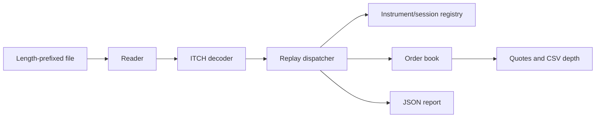

# Nasdaq ITCH Market Data Feed Handler

A C++20 library and command-line application that reconstructs displayed order books from recorded Nasdaq TotalView-ITCH 5.0 messages. It decodes binary fields, applies order lifecycle events, and publishes best bid/ask, market depth, CSV snapshots, and JSON processing statistics.

The project demonstrates protocol parsing, explicit ownership, event-driven state updates, deterministic testing, and reproducible performance measurement. It is an offline educational implementation, not a production feed service.

## Build and run

Prerequisites: a C++20 compiler (Apple Clang, Clang, or GCC), CMake 3.24+, and Python 3 for CLI integration tests. CMake uses an installed GoogleTest >=1.14 or downloads pinned GoogleTest 1.15.2 with a verified SHA-256. The application has no third-party runtime dependencies.

```sh
cmake -S . -B build -DCMAKE_BUILD_TYPE=Release
cmake --build build --parallel
ctest --test-dir build --output-on-failure
./build/itch_replay --input tests/fixtures/demo.itch --symbol AAPL --depth 5 --report report.json
```

Expected demo quote output:

```text
AAPL state=T session=C
BID 1 150.0100 qty=70 orders=1
ASK 1 150.0500 qty=110 orders=1
messages=16 unsupported=1 active_orders=2 elapsed_seconds=...
```

The final state is retained after the end-of-messages event. These are historical end-of-replay quotes, not live tradable prices. Omit `--symbol` to reconstruct AAPL and MSFT. The fixture contains all supported message types, two symbols, a price-changing replacement, and a skipped trade message. Expected values are recorded in `tests/fixtures/expected.json`.

```sh
./build/itch_replay --input tests/fixtures/demo.itch --snapshots snapshots.csv --snapshot-every 8
./build/generate_fixture regenerated.itch
```

The generated default fixture is byte-for-byte identical to the committed fixture. Numeric options must be positive. `--depth` defaults to 5, and `--snapshot-every` to 100000. CSV rows are emitted only for nonempty levels at each interval; an interval is not automatically added at EOF. Final stdout always shows the book, including explicit empty sides.

## Architecture



`itch_core` is reusable independently of the CLI. The decoder accepts a byte span; the reader owns a reusable frame buffer; the book owns its orders and levels. Processing is single-threaded and preserves input order.

- `include/itch/`: public library interfaces and typed events.
- `src/`: decoder, streaming reader, registry, book, reporting, and CLI.
- `tests/`: field-level, lifecycle, generated-reference, fixture, and CLI tests.
- `tools/`: reproducible synthetic input generator.
- `benchmarks/`: in-memory decoding and complete processing benchmark.
- `docs/`: design decisions, supported protocol behavior, and measured performance.

See [architecture](docs/architecture.md), [protocol support](docs/protocol-support.md), and [performance](docs/performance.md).

## Correctness and failure behavior

Supported state-changing messages are validated before book mutation. Duplicate active IDs, missing references, mismatched stock locates, zero quantities, and excessive reductions fail explicitly. Prices are integer units of 0.0001; no floating-point arithmetic is used for prices or volume.

Malformed input and invalid transitions stop replay with a nonzero exit status. Message errors carry a byte offset and message type. A requested JSON report records partial metrics and `complete: false` on replay failure. Partial CSV snapshots may remain and must not be interpreted as a complete replay. Setup or output-file failures go to stderr; a report cannot be guaranteed if its output path is unwritable.

A symbol filter builds only the selected book. All supported messages are structurally decoded and directory identities are checked, but order lifecycle consistency is checked only for retained symbols. Unknown message types with a valid common header are counted and skipped; therefore success means successful processing of the documented subset, not proof of complete future-protocol coverage.

## Testing and CI

The suite includes independent literal-byte decoding, every truncation of the synthetic messages, both execution types, partial cancellations, replacement collisions, empty inputs, invalid CLI arguments, output-path alias protection, snapshots, and deterministic replay. A seeded 5,000-event test compares aggregate levels against a separate reference implementation that sums individual orders after each event.

```sh
cmake -S . -B build-sanitized -DCMAKE_BUILD_TYPE=Debug -DITCH_SANITIZERS=ON
cmake --build build-sanitized --parallel
ctest --test-dir build-sanitized --output-on-failure
```

GitHub Actions defines Debug/Release jobs on Linux and macOS and an ASan/UBSan job on Linux. Local verification results are recorded in the performance document; the initial Linux/macOS and Linux sanitizer run passed, with the exact run linked in that document.

For an offline build, provide an existing GoogleTest source checkout with `-DFETCHCONTENT_SOURCE_DIR_GOOGLETEST=/path/to/googletest`, or build the application without tests using `-DBUILD_TESTING=OFF`.

## Data and limits

Use the included synthetic data immediately. Historical files must be obtained separately under the provider's terms, decompressed, and confirmed to use **two-byte big-endian payload length followed by one ITCH message**. Raw PCAP, SoupBinTCP sessions, MoldUDP64 packets, compressed files, and concatenated daily sessions are not accepted. Historical data access has not been verified. Large datasets are excluded from Git.

There is no exchange connectivity, order submission, trading strategy, persistence, or graphical dashboard. Trading states are retained and displayed; the application does not decide whether trading is permitted. Standalone trade reports do not modify displayed orders. Start from a complete session containing the required directory and order history; arbitrary mid-session slices may fail with missing references.

## Portfolio presentation

Demo the synthetic replay, show a malformed-input report, explain replacement handling, and discuss why a single processing thread and integer prices simplify correctness. Discuss benchmark scope and its limitations before quoting performance numbers.

Suggested resume wording, after reviewing and understanding the implementation:

> Built a C++20 Nasdaq ITCH replay engine with displayed order-book reconstruction, deterministic reference-model tests, CSV depth snapshots, JSON diagnostics, and reproducible throughput benchmarks.

Add only measurements from the documented workload. No live exchange-to-application latency or production readiness is claimed.

## Baseline comparisons

Use the optional [same-host comparison harness](benchmarks/comparison/README.md) to compare against a pinned open-source C++ ITCH implementation. It checks both engines against an independently generated final book before collecting paired timings on multi-symbol, deep-book, and wide-market synthetic workloads.

[Initial comparison results](docs/comparison-baseline/README.md): both engines passed the independent oracle; the external peer was faster on all three synthetic profiles. This is a baseline for engineering improvements, not a claimed speed advantage.
